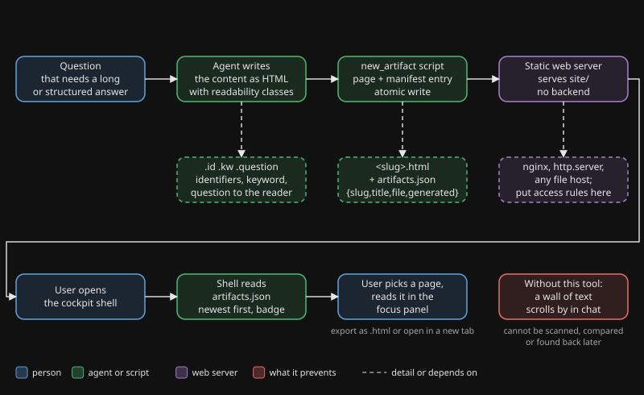

# cockpit

## Why

A chat is a fleeting, narrow channel. Output that someone has to scan, compare or find again later, such as a report, a diagnosis, a table or a decision overview, belongs on a page with proper formatting. In a chat it scrolls away.

Changing how the agent writes is not the answer. An output style inside the agent changes the behaviour of the agent itself, not just the look of the result. A separate browser channel leaves the agent's answers alone and gives the structured output its own place.

Readers who prefer structure over prose also benefit. They read a page. They skip a wall of chat text.

## What it does

The agent writes its content as an HTML fragment and runs one script. The script wraps the fragment in a readable, self-contained page, saves it, and adds it to a manifest. A small shell page shows the list of pages on the right and the selected page in a focus panel. The shell has no chat: it is a presentation layer for people who read what the agent produced.

## Flow

You see the agent writing content, the script turning it into a page plus a manifest entry, a static server handing both out, and the user opening the shell, choosing the page in the list and reading it in the focus panel.

## When to use it, when not

| Use it | Skip it |
|---|---|
| A report, diagnosis or overview someone will read later | A one-line answer |
| A comparison or table | A quick yes/no confirmation |
| A decision list the user has to work through | A question that needs a reply right now |
| Output the user may want to find again | Output that is only useful in this turn |
| Content with diagrams or images | Anything secret: pages are plain static files |

## Evidence

These are observations from the author's own use, not a controlled study.

- **2026-06-19.** The author first tried an output style to make the agent's answers more readable. It changed the answering behaviour of the agent itself. The author then chose the browser channel as a separate track.
- **Since June 2026.** More than two hundred pages have been published with it: reports, diagnoses, decision overviews and drawings.
- **2026-06-20.** Manifest-driven navigation was added. The reader no longer needs to know a single URL, because the list shows what exists, newest first.
- **Readability research.** It led to monospace identifiers with a slashed zero and one key word per paragraph. It led away from Bionic Reading and from a dyslexia font, which showed no effect or a negative one.

## Install

1. Copy `tool/` to `tools/cockpit/` in your project.
2. Serve `tools/cockpit/site/` with any static web server. For a first look: `cd tools/cockpit/site && python3 -m http.server 8900`.
3. Tell your agent when something becomes a page, how to call `scripts/New-Artifact.ps1` or `scripts/new_artifact.py`, and which classes to use. A skill or an instruction block works well.
4. Optional: put your own title in `site/config.json`, and put the server behind your own access rules.

The technical details, the manifest schema and the limits are in `tool/README.md`. See `examples/how-the-author-uses-it.md` for one real setup.

Dutch version: [README.nl.md](README.nl.md).
