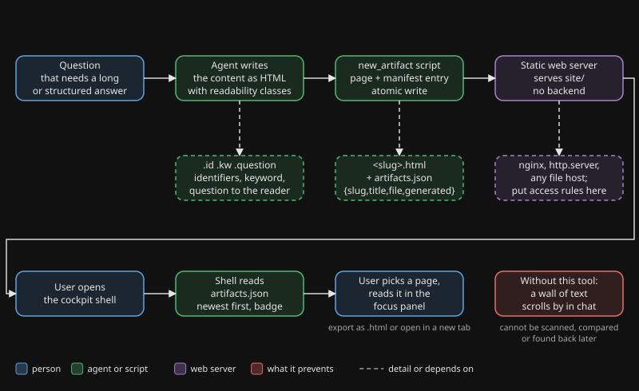

# cockpit

## Waarom

Een chat is een vluchtig, smal kanaal. Output die iemand moet scannen, vergelijken of later terug moet vinden, zoals een rapport, een diagnose, een tabel of een besluit-overzicht, hoort op een pagina met opmaak. In een chat scrolt het weg.

Het gedrag van de agent aanpassen is het antwoord niet. Een output-style in de agent zelf verandert het gedrag van de agent, niet alleen het uiterlijk van het resultaat. Een apart browser-kanaal laat de antwoorden van de agent met rust en geeft de gestructureerde output een eigen plek.

Lezers die structuur boven proza verkiezen hebben er ook baat bij. Zij lezen een pagina. Een lap chattekst slaan ze over.

## Wat het doet

De agent schrijft zijn inhoud als HTML-fragment en draait één script. Het script verpakt het fragment in een leesbare, zelfstandige pagina, slaat die op en voegt hem toe aan een manifest. Een kleine shell-pagina toont rechts de lijst met pagina's en in een focus-paneel de gekozen pagina. De shell heeft geen chat: het is een presentatielaag voor mensen die lezen wat de agent heeft gemaakt.

## Flow

Je ziet de agent die inhoud schrijft, het script dat er een pagina plus een manifest-regel van maakt, een statische server die beide uitdeelt, en de gebruiker die de shell opent, de pagina in de lijst kiest en hem leest in het focus-paneel.

## Wanneer wel, wanneer niet

| Wel gebruiken | Overslaan |
|---|---|
| Een rapport, diagnose of overzicht dat iemand later leest | Een antwoord van één regel |
| Een vergelijking of tabel | Een snelle ja/nee-bevestiging |
| Een besluitenlijst die de gebruiker moet doorwerken | Een vraag die nu een antwoord nodig heeft |
| Output die de gebruiker wil terugvinden | Output die alleen in deze beurt nuttig is |
| Inhoud met tekeningen of afbeeldingen | Alles wat geheim is: pagina's zijn gewone statische bestanden |

## Bewijs

Dit zijn waarnemingen uit het eigen gebruik van de auteur, geen gecontroleerd onderzoek.

- **2026-06-19.** De auteur probeerde eerst een output-style om de antwoorden leesbaarder te maken. Die veranderde het antwoordgedrag van de agent zelf. De auteur koos daarna het browser-kanaal als apart spoor.
- **Sinds juni 2026.** Er zijn ruim tweehonderd pagina's mee gepubliceerd: rapporten, diagnoses, besluit-overzichten en tekeningen.
- **2026-06-20.** Manifest-gedreven navigatie werd toegevoegd. De lezer hoeft geen losse URL meer te kennen, want de lijst toont wat er is, nieuwste eerst.
- **Onderzoek naar leesbaarheid.** Dat leidde tot monospace-identifiers met slashed zero en één kernwoord per alinea. Het leidde weg van Bionic Reading en van een dyslexie-font, die geen of een negatief effect lieten zien.

## Installeren

1. Kopieer `tool/` naar `tools/cockpit/` in je project.
2. Serveer `tools/cockpit/site/` met een willekeurige statische webserver. Voor een eerste blik: `cd tools/cockpit/site && python3 -m http.server 8900`.
3. Vertel je agent wanneer iets een pagina wordt, hoe hij `scripts/New-Artifact.ps1` of `scripts/new_artifact.py` aanroept en welke klassen hij gebruikt. Een skill of een instructieblok werkt goed.
4. Optioneel: zet je eigen titel in `site/config.json` en zet de server achter je eigen toegangsregels.

De technische details, het manifest-schema en de grenzen staan in `tool/README.md`. Zie `examples/how-the-author-uses-it.md` voor één echte opzet.

Engelse versie: [README.md](README.md).
