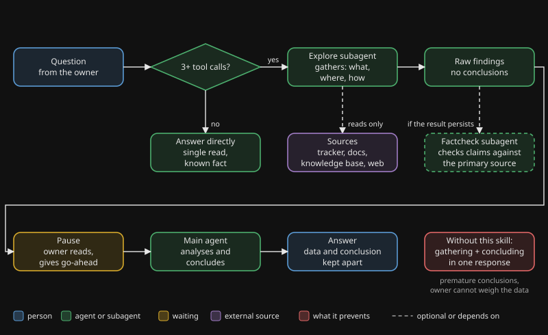

# exploring-first

## Why

An agent that is trained to give complete answers does two jobs in one response: it gathers information and it draws a conclusion. The conclusion then rests on the first few queries, and the agent does not notice. Telling it to "research first, then answer" helps for a while and fails under pressure, because the instruction competes with the drive to answer completely.

A second problem sits on top. The agent underestimates how much it has to look up. It thinks "one call and I know", then makes five or more calls, mixed with conclusions.

## What it does

The skill moves the gathering into a subagent. The main agent receives the raw findings as a separate result, shows them without conclusions, and waits for a go-ahead before it analyses. For research that ends in a lasting document, a second independent subagent checks the claims against the primary source.

The brake is mechanical. It does not depend on the agent remembering a rule.

## Flow

You see a question going to a subagent that gathers the information, the raw findings coming back, a pause for the go-ahead, and only then the main agent doing the analysis.

## When to use it, when not

| Use it | Skip it |
|---|---|
| Three or more tool calls expected | Reading one file at a known path |
| Inventory of a codebase, tracker or system | A grep for one symbol |
| Diagnosis across several sources | One API endpoint check |
| Project history and past decisions | A fact already in your context |
| Research on an unfamiliar topic | A simple yes/no confirmation |
| Before re-opening an existing decision | Loading your own start-up context (read it yourself) |

## Evidence

These are observations from the author's own use, not a controlled study.

- **2026-04-23.** A first research subagent summarised several papers. Titles and authors were correct. The internal roles it described for two of the papers were invented. Only a factcheck against the PDFs themselves caught it.
- **2026-05-04.** A factcheck caught an abbreviation ambiguity: an amount was read as billions where the source said trillions. The author had not seen it.
- **Recurring pattern.** Before using the skill, the agent regularly estimated one query and made five or more, with conclusions mixed in. This was confirmed often enough that the rule for project history is now unconditional: delegate, however short the lookup feels.

## Install

1. Copy `skill/` to `.claude/skills/exploring-first/` in your project.
2. Adapt the search order in `SKILL.md` to your setup: replace the generic "project tracker" and "local knowledge base" with the names of your own tracker and search index. Remove the knowledge-base step if you have none.
3. Optional: keep a log of factcheck results so you can see a trend.

See `examples/how-the-author-uses-it.md` for one real setup.

Dutch version: [README.nl.md](README.nl.md).
