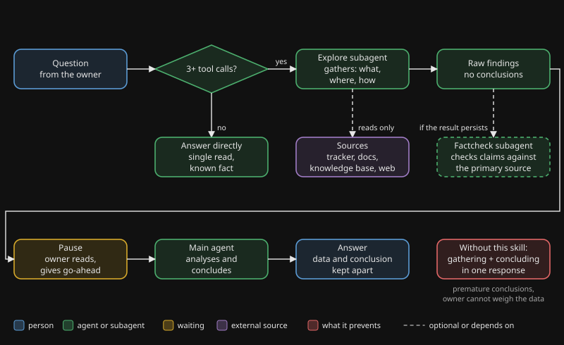

# exploring-first

## Waarom

Een agent die getraind is om complete antwoorden te geven, doet twee dingen in één antwoord: informatie verzamelen en een conclusie trekken. De conclusie rust dan op de eerste paar queries, en de agent merkt dat niet. "Zoek eerst uit, antwoord dan" helpt een tijdje en faalt onder druk, omdat de instructie concurreert met de drang om compleet te antwoorden.

Daar komt een tweede probleem bovenop. De agent onderschat hoeveel hij moet opzoeken. Hij denkt "één call en ik weet het", en doet er dan vijf of meer, gemengd met conclusies.

## Wat het doet

De skill verplaatst het verzamelen naar een subagent. De hoofdagent krijgt de ruwe bevindingen als aparte uitkomst terug, toont ze zonder conclusies en wacht op een go-ahead voordat hij analyseert. Mondt het onderzoek uit in een blijvend document, dan controleert een tweede onafhankelijke subagent de claims tegen de primaire bron.

De rem is mechanisch. Hij hangt niet af van een agent die een regel onthoudt.

## Flow

Je ziet een vraag die naar een subagent gaat die de informatie verzamelt, de ruwe bevindingen die terugkomen, een pauze voor de go-ahead, en pas daarna de hoofdagent die de analyse doet.

## Wanneer wel, wanneer niet

| Wel gebruiken | Overslaan |
|---|---|
| Drie of meer tool calls verwacht | Eén bestand lezen op een bekend pad |
| Inventarisatie van een codebase, tracker of systeem | Een grep op één symbool |
| Diagnose over meerdere bronnen | Eén API-endpoint controleren |
| Projecthistorie en eerdere besluiten | Een feit dat al in je context staat |
| Onderzoek naar een onbekend onderwerp | Een simpele ja/nee-bevestiging |
| Voordat je een bestaand besluit heropent | Je eigen startcontext laden (lees die zelf) |

## Bewijs

Dit zijn waarnemingen uit het eigen gebruik van de auteur, geen gecontroleerd onderzoek.

- **2026-04-23.** Een eerste research-subagent vatte meerdere papers samen. Titels en auteurs klopten. De interne rollen die hij voor twee van de papers beschreef, waren verzonnen. Alleen een factcheck tegen de PDF's zelf ving dat.
- **2026-05-04.** Een factcheck ving een afkortingsambiguïteit: een bedrag was gelezen als miljard waar de bron triljoen zei. De auteur had het zelf niet gezien.
- **Terugkerend patroon.** Vóór de skill schatte de agent regelmatig één query en deed er vijf of meer, met conclusies ertussen. Dat is vaak genoeg bevestigd dat de regel voor projecthistorie nu onvoorwaardelijk is: delegeer, hoe kort de opzoeking ook voelt.

## Installeren

1. Kopieer `skill/` naar `.claude/skills/exploring-first/` in je project.
2. Pas de zoekvolgorde in `SKILL.md` aan op jouw situatie: vervang de generieke "project tracker" en "local knowledge base" door de namen van je eigen tracker en zoekindex. Haal de kennisbank-stap weg als je er geen hebt.
3. Optioneel: houd een log van factcheck-uitslagen bij, zodat je een trend ziet.

Zie `examples/how-the-author-uses-it.md` voor één echte opzet.

English version: [README.md](README.md).
