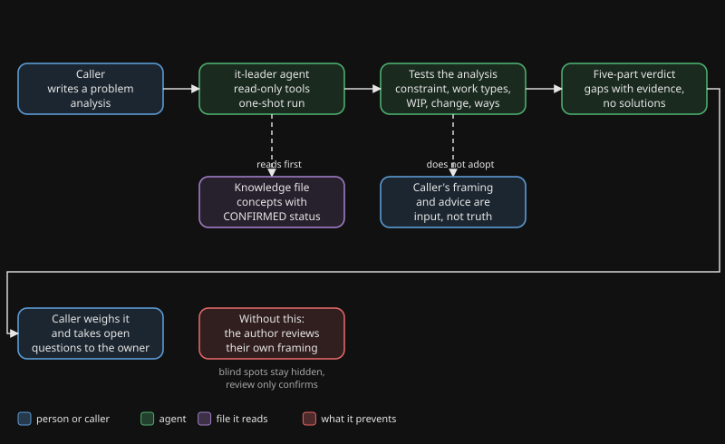

# it-leader

An independent bottleneck reviewer for AI coding agents. Unofficial: this package is an independent
work inspired by two books and is not affiliated with their authors or publisher (see Sources).

## Why

The author of a problem analysis, whether a person, a lead agent or a subagent, cannot see their own
blind spots. Asking the same agent to "check for missing bottlenecks" mostly returns a confirmation,
because the reviewer inherits the framing and the advice of the analysis it reviews.

## What it does

The agent receives a problem analysis and tests whether ALL bottlenecks were found, through one fixed
lens: the constraint, the four types of work, work in progress, unplanned work, the change process, the
three ways and the five ideals. It deliberately does not adopt the caller's framing, identifies gaps
with evidence, designs no solutions, and returns a verdict as text in a fixed five-part template. It
has read-only tools, so it cannot change anything.

The lens lives in a separate knowledge file that the agent reads at the start of every run. Each claim
in that file carries a status (CONFIRMED or UNCONFIRMED), and the agent must say when a judgement leans
on an unconfirmed claim. The file also holds sixteen **example patterns**: general work situations in
the author's own words (for example "one overloaded expert" or "a change process that exists on paper
but is bypassed"), each with the bottleneck it signals and a review question. They are not scenes from
the books.

## Flow

You see an analysis going to the reviewer, the reviewer reading its knowledge file, testing the
analysis against the lens, and a five-part verdict coming back that the caller must weigh.

## When to use it, when not

| Use it | Skip it |
|---|---|
| Before you accept an analysis as complete | You want a solution or a plan (it designs none) |
| A team or agent is overloaded and you want to know why | A single, well-understood bug |
| You want a viewpoint that does not simply agree with you | You need a fact checked against a source (use a factcheck step) |
| Reviewing a process for waiting, hidden work and bypassed change control | The analysis is not written down yet |

## Use it in two rounds

One review finds most bottlenecks, not all. Run a second, fresh review with the first verdict attached
and a fixed follow-up question:

> Which bottleneck did you miss? Walk through every concept and every example pattern in your knowledge
> file and lay each one next to the analysis. Where do you disagree with your own first round?

Each round is a one-shot run, so nothing depends on a long back-and-forth with the reviewer.

## Evidence

One small test (November 2026), not a controlled study. One real problem analysis of about 3,200 words
was reviewed by three variants, each run twice in two rounds, and judged blind by a separate run:

| Variant | Blind rank | Depth (1-5) |
|---|---|---|
| Concepts only (version 1.0.0) | 5 and 6 | 3 |
| Concepts plus example patterns (this version) | 3 and 4 | 4 |
| The author's private version with richer, book-based examples | 1 and 2 | 5 |

The number of grounded bottlenecks was similar for all (23 to 26); the difference was in depth and
concreteness. The second round added 7 to 9 grounded findings per run, about a third of the total. The
design idea behind the agent: a reviewer given the caller's framing tends to confirm it, while one with
a fixed external lens and a mandatory "where do I disagree" section finds what the author had not
listed. Treat all of this as an indication, not as proof.

## Install

1. Copy the contents of `agent/` to `.claude/agents/` in your project. You get two files:
   `it-leader.md` (the agent) and `it-leader-knowledge.md` (what it reads first).
2. Adapt the review focus. The agent text says "the phase under review"; tell the agent in your call
   which phase or scope you mean.
3. Call it with the analysis to review (paths or pasted text). See `examples/example-call.md`.
4. Then run the second round (see "Use it in two rounds").

## Sources

- Gene Kim, Kevin Behr, George Spafford, *The Phoenix Project*.
- Gene Kim, *The Unicorn Project*.
- Eliyahu M. Goldratt, *The Goal* (Theory of Constraints, which the first book builds on).

The concepts are described in the author's own words; no passages, dialogue or long quotes are
copied. Both books are copyrighted works of their authors. Read the books for the real thing.

Nederlandse versie: [README.nl.md](README.nl.md).
