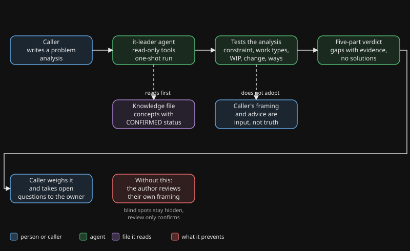

# it-leader

Een onafhankelijke bottleneck-reviewer voor AI-codeeragents. Niet-officieel: dit package is een
onafhankelijk werk, geïnspireerd op twee boeken, en niet verbonden aan de auteurs of de uitgever
(zie Bronnen).

## Waarom

De schrijver van een probleemanalyse, of dat nu een mens, een leidende agent of een subagent is, ziet
zijn eigen blinde vlekken niet. Dezelfde agent vragen om "te controleren op ontbrekende bottlenecks"
levert meestal een bevestiging op, omdat de reviewer de framing en het advies van de analyse erft.

## Wat het doet

De agent krijgt een probleemanalyse en toetst of ALLE bottlenecks gevonden zijn, door één vaste lens:
de constraint, de vier soorten werk, werk in uitvoering, ongepland werk, het change-proces, de drie
wegen en de vijf idealen. Hij gaat bewust niet mee met de framing van de aanroeper, benoemt gaten met
bewijs, ontwerpt geen oplossingen en levert een oordeel als tekst in een vast sjabloon van vijf delen.
Hij heeft alleen leesgereedschap, dus hij kan niets wijzigen.

De lens staat in een apart kennisbestand dat de agent bij elke run eerst leest. Elke bewering daarin
heeft een status (CONFIRMED of UNCONFIRMED), en de agent moet melden als een oordeel op een
onbevestigde bewering leunt. Het bestand bevat ook zestien **voorbeeld-patronen**: algemene
werksituaties in de eigen woorden van de auteur (bijvoorbeeld "één overbelaste expert" of "een
change-proces dat op papier bestaat maar wordt omzeild"), elk met de bottleneck die het aangeeft en een
reviewvraag. Het zijn geen scènes uit de boeken.

## Flow

Je ziet een analyse naar de reviewer gaan, de reviewer die zijn kennisbestand leest, de analyse toetst
aan de lens, en een oordeel in vijf delen dat terugkomt en dat de aanroeper moet wegen.

## Wanneer gebruiken, wanneer niet

| Gebruik het | Sla het over |
|---|---|
| Voordat je een analyse als compleet accepteert | Je wilt een oplossing of plan (hij ontwerpt er geen) |
| Een team of agent is overbelast en je wilt weten waarom | Eén simpele, goed begrepen bug |
| Je wilt een kijkhoek die niet zomaar met je meegaat | Je wilt een feit tegen een bron controleren (gebruik een factcheck-stap) |
| Een proces toetsen op wachten, verborgen werk en omzeild change-beheer | De analyse is nog niet opgeschreven |

## Gebruik het in twee rondes

Eén review vindt de meeste bottlenecks, niet alle. Draai een tweede, verse review met het eerste
oordeel erbij en een vaste doorvraag:

> Welke bottleneck heb je gemist? Loop elk concept en elk voorbeeld-patroon uit je kennisbestand langs en
> leg het naast de analyse. Waar ben je het met je eigen eerste ronde oneens?

Elke ronde is een losse run, dus niets hangt af van een lang heen-en-weer met de reviewer.

## Bewijs

Eén kleine test (november 2026), geen gecontroleerd onderzoek. Eén echte probleemanalyse van ongeveer
3.200 woorden werd door drie varianten getoetst, elk twee keer in twee rondes, en blind beoordeeld door
een aparte run:

| Variant | Blinde rang | Diepte (1-5) |
|---|---|---|
| Alleen concepten (versie 1.0.0) | 5 en 6 | 3 |
| Concepten plus voorbeeld-patronen (deze versie) | 3 en 4 | 4 |
| De eigen, private versie van de auteur met rijkere voorbeelden uit de boeken | 1 en 2 | 5 |

Het aantal gegronde bottlenecks was bij alle varianten vergelijkbaar (23 tot 26); het verschil zat in
diepte en concreetheid. De tweede ronde leverde per run 7 tot 9 gegronde bevindingen extra op, ongeveer
een derde van het totaal. Het ontwerpidee achter de agent: een reviewer die de framing van de aanroeper
meekrijgt, bevestigt die meestal, terwijl een reviewer met een vaste externe lens en een verplicht
onderdeel "waar ben ik het oneens" vindt wat de schrijver niet op zijn lijst had. Zie dit alles als een
aanwijzing, niet als bewijs.

## Installeren

1. Kopieer de inhoud van `agent/` naar `.claude/agents/` in je project. Je krijgt twee bestanden:
   `it-leader.md` (de agent) en `it-leader-knowledge.md` (wat hij eerst leest).
2. Stem de focus af. De agenttekst spreekt van "the phase under review"; zeg in je aanroep welke fase
   of scope je bedoelt.
3. Roep hem aan met de te toetsen analyse (paden of geplakte tekst). Zie `examples/example-call.md`.
4. Draai daarna de tweede ronde (zie "Gebruik het in twee rondes").

## Bronnen

- Gene Kim, Kevin Behr, George Spafford, *The Phoenix Project*.
- Gene Kim, *The Unicorn Project*.
- Eliyahu M. Goldratt, *The Goal* (Theory of Constraints, waarop het eerste boek voortbouwt).

De concepten zijn in eigen woorden beschreven; er zijn geen passages, dialogen of lange citaten
overgenomen. Beide boeken zijn auteursrechtelijk beschermde werken van hun auteurs. Lees de boeken
voor het echte werk.

English version: [README.md](README.md).
