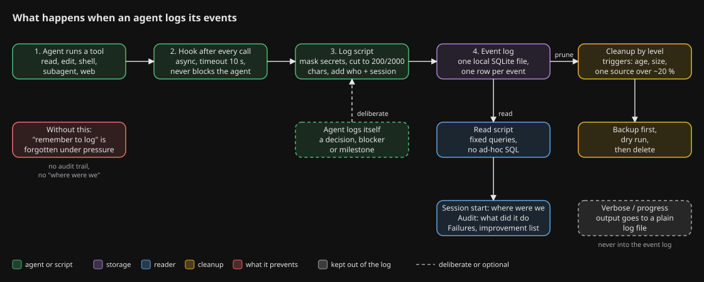

# logging-agent-events

## Why

An AI coding agent forgets what it did. The context window fills up and early work is summarised away, a session can crash or close, and the owner has no record of which commands ran, which files changed or what failed.

The obvious fix, an instruction such as "log your important steps", does not hold. An agent drops instructions exactly when it is busy, which is when logging matters most. Logging has to be a mechanism, not a habit.

## What it does

A hook fires after every tool call and hands the call to a small script, which masks secrets, shortens the text and writes one row to a local SQLite file. The agent can also log deliberate events itself: a decision, a blocker, a milestone. The hook runs outside the agent's context window, so logging costs no tokens and no attention.

The result is a local, queryable record of what the agent did, next to your tracker (what should happen) and the agent's memory (what it remembers).

## Which hooks

A hook is a built-in feature of Claude Code: at a fixed moment it runs a command that you name in `.claude/settings.json`. You do not build the hook. You install the script and add two entries (they are in `addition/hooks.example.json`):

| Hook event | Fires | The script writes |
|---|---|---|
| `PostToolUse` | after every successful tool call: shell command, file edit, search, web fetch | one row with `success = 1` |
| `PostToolUseFailure` | after every failed tool call | one row with `success = 0` and the error text |

Both entries use matcher `*` (every tool) and `async: true`, so the agent does not wait for the write. Claude Code hands the call to the script as JSON on standard input: session id, tool name, the input and the result.

## Flow

You see a tool call going through the hook and the log script into the event log, the agent adding deliberate events through the same script, readers using the log for session start and audit, and cleanup by level with a backup first.

## When to use it, when not

| Use it | Skip it |
|---|---|
| You want to know afterwards what an agent did and what failed | One-off sessions you will never look back at |
| Several agents or sessions work in parallel and you need to tell them apart | Your platform already keeps a searchable audit log you can query |
| You want "where were we" at the start of a session from data, not from memory | You are not allowed to store commands and tool output on the machine |
| You want a list of where the agent got stuck, to improve your instructions | You have no plan to clean up (read [the lessons](addition/README.md#lessons) first) |

## Evidence

These are observations from the author's own use since April 2026, not a controlled study.

- **Seven months, one person, two or three agent sessions at a time:** about 1.58 million events, about 7,500 per day on average and over 12,000 on a busy day. The file is about 1.1 GB, roughly 700 bytes per event.
- **Before the hook there was no event record at all;** memory and session notes were kept by hand. Since the hook, every tool call is in the log without the agent doing anything. Deliberate events still depend on instructions, so they are logged at fixed moments (decisions, blockers, milestones) named in the agent's workflow.
- **One noisy source took 30 % of the rows (November 2026).** A helper function wrote two progress lines on every call. Nobody read them. Since then, `verbose` and `progress` lines go to a plain log file, never to the event log.
- **The original script masked nothing.** Every command was stored as typed, so the only protection was the rule "never put a secret value in a command". This package masks in the script as a second layer.
- **Cleanup was planned but never automated.** The file grew to over 1 GB before cleanup was designed. Plan it from day one; see [cleanup by level](addition/README.md#cleanup-by-level).

## Install

1. Copy `addition/` to `tools/agent-events/` in your project.
2. Install the PowerShell module the script uses: `Install-Module PSSQLite -Scope CurrentUser` (PowerShell 7).
3. Merge `addition/hooks.example.json` into `.claude/settings.json` and replace `<project-root>`.
4. Set `AGENT_EVENTS_DB` to an **absolute** path, for example `<project-root>/data/events.db`. Without it the database lands in `data/` under whatever folder the agent is in, so a `cd` creates a second log. Also set `AGENT_NAME` (and `AGENT_TOPIC` if you like) when several agents run in parallel. Set them before the session starts; hooks inherit the environment at launch.
5. **Keep the log out of version control:** add the database and its `-wal` and `-shm` files to `.gitignore`, and make the file readable only for yourself. It holds commands and tool output.
6. Add one line to your start-up instruction: read the last events of the previous session.
7. Decide on retention per level before the file grows. See `addition/README.md`.

No hook mechanism on your platform? Use the deliberate mode only (`log-event.ps1 -EventType decision -Summary "..."`). That is weaker, because it depends on the agent remembering, so say so to whoever relies on the log.

See `examples/how-the-author-uses-it.md` for one real setup.

Dutch version: [README.nl.md](README.nl.md).
