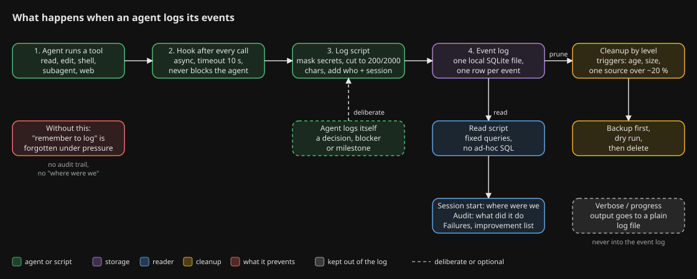

# logging-agent-events

## Waarom

Een AI-agent vergeet wat hij gedaan heeft. Het context-venster loopt vol en vroeg werk wordt weggevat, een sessie kan crashen of sluiten, en de eigenaar heeft geen overzicht van welke commando's draaiden, welke bestanden veranderden of wat er misging.

De voor de hand liggende oplossing, een instructie als "log je belangrijke stappen", houdt geen stand. Een agent laat instructies juist vallen als hij druk is, en dan is loggen het belangrijkst. Loggen moet een mechanisme zijn, geen gewoonte.

## Wat het doet

Een hook vuurt na elke tool-aanroep en geeft die door aan een klein script. Dat maskeert geheimen, kort de tekst in en schrijft één rij naar een lokaal SQLite-bestand. De agent kan ook zelf bewuste events loggen: een besluit, een blokkade, een mijlpaal. De hook draait buiten het context-venster van de agent, dus loggen kost geen tokens en geen aandacht.

Het resultaat is een lokaal, doorzoekbaar verslag van wat de agent deed, naast je takenlijst (wat moet er gebeuren) en het geheugen van de agent (wat onthoudt hij).

## Welke hooks

Een hook is een ingebouwde functie van Claude Code: op een vast moment draait die een commando dat je in `.claude/settings.json` opgeeft. De hook bouw je niet. Je installeert het script en voegt twee regels toe (ze staan in `addition/hooks.example.json`):

| Hook-moment | Vuurt | Het script schrijft |
|---|---|---|
| `PostToolUse` | na elke geslaagde tool-aanroep: shell-commando, bestandswijziging, zoekactie, webpagina ophalen | één rij met `success = 1` |
| `PostToolUseFailure` | na elke mislukte tool-aanroep | één rij met `success = 0` en de fouttekst |

Beide regels gebruiken matcher `*` (elke tool) en `async: true`, zodat de agent niet op het schrijven wacht. Claude Code geeft de aanroep als JSON op standaard-invoer aan het script: sessie-id, toolnaam, de invoer en het resultaat.

## Stroom

Je ziet een tool-aanroep via de hook en het log-script in de event-log komen, de agent die via hetzelfde script bewuste events toevoegt, lezers die de log gebruiken bij de sessie-start en voor audit, en opruimen per niveau met eerst een backup.

## Wanneer wel, wanneer niet

| Gebruik het | Sla het over |
|---|---|
| Je wilt achteraf weten wat een agent deed en wat mislukte | Eenmalige sessies waar je nooit op terugkijkt |
| Meerdere agents of sessies werken tegelijk en je wilt ze uit elkaar houden | Je platform houdt al een doorzoekbare audit-log bij |
| Je wilt bij de sessie-start "waar waren we" uit data halen, niet uit het geheugen | Je mag commando's en tool-uitvoer niet op de machine opslaan |
| Je wilt een lijst van waar de agent vastliep, om je instructies te verbeteren | Je hebt geen plan om op te ruimen (lees eerst [de lessen](addition/README.md#lessons)) |

## Bewijs

Dit zijn waarnemingen uit het eigen gebruik van de auteur sinds april 2026, geen gecontroleerd onderzoek.

- **Zeven maanden, één persoon, twee of drie agent-sessies tegelijk:** ongeveer 1,58 miljoen events, gemiddeld ongeveer 7.500 per dag en ruim 12.000 op een drukke dag. Het bestand is ongeveer 1,1 GB, zo'n 700 bytes per event.
- **Vóór de hook was er helemaal geen event-registratie;** geheugen en sessieverslagen waren handwerk. Sinds de hook staat elke tool-aanroep in de log zonder dat de agent iets doet. Bewuste events hangen nog steeds af van instructies, dus die worden op vaste momenten gelogd (besluiten, blokkades, mijlpalen) die in de werkwijze van de agent staan.
- **Eén luidruchtige bron vulde 30% van de rijen (november 2026).** Een hulpfunctie schreef bij elke aanroep twee voortgangsregels. Niemand las ze. Sindsdien gaan `verbose`- en `progress`-regels naar een gewoon logbestand, nooit naar de event-log.
- **Het oorspronkelijke script maskeerde niets.** Elk commando werd opgeslagen zoals het getypt was, dus de enige bescherming was de regel "nooit een geheime waarde in een commando". Dit package maskeert in het script, als tweede laag.
- **Opruimen was gepland maar nooit geautomatiseerd.** Het bestand groeide voorbij 1 GB voordat opruimen ontworpen werd. Plan het vanaf dag één; zie [opruimen per niveau](addition/README.md#cleanup-by-level).

## Installeren

1. Kopieer `addition/` naar `tools/agent-events/` in je project.
2. Installeer de PowerShell-module die het script gebruikt: `Install-Module PSSQLite -Scope CurrentUser` (PowerShell 7).
3. Voeg `addition/hooks.example.json` samen met `.claude/settings.json` en vervang `<project-root>`.
4. Zet `AGENT_EVENTS_DB` op een **absoluut** pad, bijvoorbeeld `<project-root>/data/events.db`. Zonder die variabele komt de database in `data/` onder de map waar de agent op dat moment staat, dus een `cd` maakt een tweede log. Zet ook `AGENT_NAME` (en eventueel `AGENT_TOPIC`) als er meerdere agents tegelijk draaien. Zet ze vóór de sessie start; hooks erven de omgeving bij het starten.
5. **Houd de log buiten versiebeheer:** zet de database en de bijbehorende `-wal`- en `-shm`-bestanden in `.gitignore`, en maak het bestand alleen voor jezelf leesbaar. Er staan commando's en tool-uitvoer in.
6. Zet één regel in je opstart-instructie: lees de laatste events van de vorige sessie.
7. Bepaal de bewaartermijn per niveau voordat het bestand groeit. Zie `addition/README.md`.

Geen hook-mechanisme op je platform? Gebruik dan alleen de bewuste modus (`log-event.ps1 -EventType decision -Summary "..."`). Dat is zwakker, omdat het afhangt van het geheugen van de agent; zeg dat ook tegen wie op de log vertrouwt.

Zie `examples/how-the-author-uses-it.md` voor één echte opzet.

English version: [README.md](README.md).
