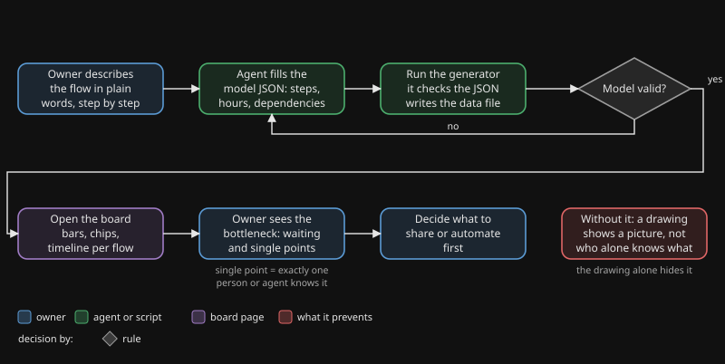

# making-flows-visible

## Why

A drawing of a flow is a picture. It shows the steps, but not where the time goes, what each step leans on, or who is the only one who knows how something works. Those three things decide whether a flow keeps running when someone is away, and they are exactly what a drawing leaves out.

When an agent does part of the work, the question gets sharper. Some knowledge sits with the agent, some only with the owner, and some with nobody. Nobody sees that until the day the one person who knew it is unavailable.

## What it does

You describe each flow as a small JSON file: steps, hours per step, who does them and what they lean on. A script checks the files and writes one data file. A static page then shows, per flow, a bar of work, human action and waiting, the dependencies as chips, and a red mark on every dependency that exactly one person or agent knows. One view shows flow, waiting time, dependencies and single points of knowledge together.

## Flow

You see the owner describing a flow, the model being filled in and checked in a loop until it is valid, the board opening, the owner reading the bottleneck, and the decision about what to share or automate first.

## When to use it, when not

| Use it | Skip it |
|---|---|
| A flow repeats and you want to know where the time goes | A one-off task with a single step |
| Work is shared between people and agents | One person doing everything, nothing to share |
| You suspect that one person holds knowledge nobody else has | You only need a picture of the steps; draw it instead |
| You want to decide what to document, share or automate first | The numbers would be pure guesswork and nobody will check them |
| You compare the current way of working with a design | A flow that changes every day |

## Evidence

These are observations from the author's own use, not a controlled study.

- **2026-11-09.** The author put two flows on the board: a firewall change and publishing a package. One view showed 17 dependencies, of which 10 had exactly one person or agent who knew them. The flow drawings had not shown this.
- **Same day.** In both flows 80 percent or more of the lead time was waiting, not work. That moved the question from "how do we speed up the work" to "how do we shorten the wait".
- **Same day.** The same page code runs a second board for a whole department. Only the framework is shared; the data of each board stays with its owner.

## Install

1. Copy `tool/` to `tools/flow-board/` in your project.
2. Replace the example in `tools/flow-board/model/` with your own people, dependencies and flows. `model/flows/_template.json` is a starting point for a flow.
3. Run `python3 -I tools/generate_bord.py` from `tools/flow-board/`. Fix what it reports.
4. Serve `tools/flow-board/` with any static web server and open `index.html`. For a first look: `cd tools/flow-board && python3 -m http.server 8900`.
5. Optional: set `taal` (`nl` or `en`) and `titel` in `model/config.json`.

The generator expects Dutch file names and keys. They are not renamed on purpose, and `tool/README.md` has a table with the English meaning of each one. See `examples/how-the-author-uses-it.md` for one real setup.

Dutch version: [README.nl.md](README.nl.md).
