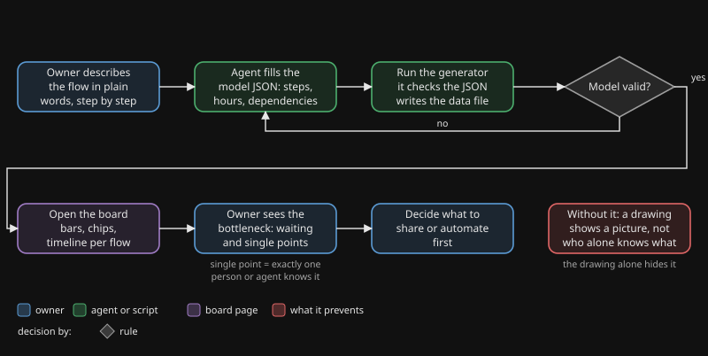

# making-flows-visible

## Waarom

Een tekening van een flow is een plaatje. Je ziet de stappen, maar niet waar de tijd blijft, waar elke stap op leunt, of wie als enige weet hoe iets werkt. Juist die drie dingen bepalen of een flow blijft draaien als iemand afwezig is, en een tekening laat ze weg.

Als een agent een deel van het werk doet, wordt de vraag scherper. Sommige kennis zit bij de agent, sommige alleen bij de eigenaar en sommige bij niemand. Dat ziet niemand, tot de dag dat de enige die het wist er niet is.

## Wat het doet

Je beschrijft elke flow als een klein JSON-bestand: stappen, uren per stap, wie ze doet en waar ze op leunen. Een script controleert de bestanden en schrijft één databestand. Een statische pagina toont dan per flow een balk met werk, menselijke actie en wachten, de afhankelijkheden als chips, en een rode markering bij elke afhankelijkheid die precies één persoon of agent kent. Eén beeld toont flow, wachttijd, afhankelijkheden en enkele kenners samen.

## Flow

Je ziet de eigenaar die een flow beschrijft, het model dat wordt ingevuld en in een lus gecontroleerd tot het klopt, het bord dat opent, de eigenaar die de flessenhals leest, en het besluit wat als eerste gedeeld of geautomatiseerd wordt. De tekening is in het Engels.

## Wanneer wel, wanneer niet

| Wel gebruiken | Overslaan |
|---|---|
| Een flow herhaalt zich en je wilt weten waar de tijd blijft | Een eenmalige taak met één stap |
| Werk wordt gedeeld tussen mensen en agents | Eén persoon doet alles, er is niets te delen |
| Je vermoedt dat één persoon kennis heeft die niemand anders heeft | Je wilt alleen een plaatje van de stappen; teken dat dan |
| Je wilt bepalen wat je als eerste documenteert, deelt of automatiseert | De getallen zijn pure gok en niemand toetst ze |
| Je vergelijkt de huidige werkwijze met een ontwerp | Een flow die elke dag verandert |

## Bewijs

Dit zijn waarnemingen uit eigen gebruik van de auteur, geen gecontroleerd onderzoek.

- **2026-11-09.** De auteur zette twee flows op het bord: een firewallwijziging en het publiceren van een package. Eén beeld toonde 17 afhankelijkheden, waarvan 10 met precies één persoon of agent die ze kende. De tekeningen van de flows hadden dat niet laten zien.
- **Dezelfde dag.** In beide flows was 80 procent of meer van de doorlooptijd wachten, geen werk. Daarmee verschoof de vraag van "hoe maken we het werk sneller" naar "hoe korten we het wachten in".
- **Dezelfde dag.** Dezelfde paginacode draait een tweede bord voor een hele afdeling. Alleen het raamwerk wordt gedeeld; de data van elk bord blijft bij de eigenaar.

## Installeren

1. Kopieer `tool/` naar `tools/flow-board/` in je project.
2. Vervang het voorbeeld in `tools/flow-board/model/` door je eigen mensen, afhankelijkheden en flows. `model/flows/_template.json` is een beginpunt voor een flow.
3. Draai `python3 -I tools/generate_bord.py` vanuit `tools/flow-board/`. Los op wat het meldt.
4. Serveer `tools/flow-board/` met een willekeurige statische webserver en open `index.html`. Voor een eerste blik: `cd tools/flow-board && python3 -m http.server 8900`.
5. Optioneel: zet `taal` (`nl` of `en`) en `titel` in `model/config.json`.

De generator verwacht Nederlandse bestandsnamen en sleutels. Die zijn bewust niet hernoemd, en `tool/README.md` heeft een tabel met de Engelse betekenis van elk. Zie `examples/how-the-author-uses-it.md` voor één echte opzet (in het Engels).

English version: [README.md](README.md).
