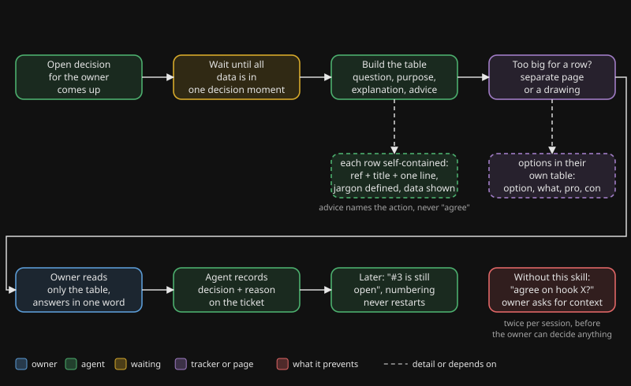

# presenting-decisions

## Why

An agent that works for a busy owner ends its answers with open questions. Left alone, those arrive as bare lines: "agree on hook X?", "ticket 50 v1 set?". The owner multitasks, skips the text between tool calls, and does not remember what ticket 50 is. To answer, they have to go back and reconstruct the context, which is the work the agent should have done.

Repeating context costs the agent almost nothing. Reconstructing it costs the owner a lot. The skill turns that asymmetry into a fixed format.

## What it does

The skill makes the agent put every decision in a table with a question, a purpose, a plain explanation and a concrete advice. The table is self-contained: a reader who sees only the table can decide, ideally with one word. It also fixes the habits around it: one row per decision, options in their own table, data shown instead of described, stable numbering, and the answer recorded on the ticket afterwards.

## Flow

You see the agent first collecting all the data, then building the table with question, purpose, explanation and advice. The owner reads only the table and answers in one word. The agent then records the decision and the reason on the ticket.

## When to use it, when not

| Use it | Skip it |
|---|---|
| One or more decisions wait for the owner | A pure status report with nothing to decide |
| A summary contains open points the owner must judge | A question you can answer yourself by reading a file |
| The owner asks "which one?" or "what is X?" | A yes/no the owner already framed in their own words |
| A session starts with "where were we" and open items | Chat where the owner is actively typing back and forth |
| A choice between options with trade-offs | A trivial default with no real alternative |

## Evidence

These are observations from the author's own use, not a controlled study.

- **Mid June 2026.** The owner had to ask for context twice per session because decisions arrived as bare lines ("agree on hook X?"). After that the table became mandatory.
- **Late June 2026.** A cell that contained all the options of a choice turned out to be unreadable. Options now get their own table.
- **Early July 2026.** A bare ticket reference ("covers issue 128") was noise the owner could not judge. Since then every reference is a number, a title and one sentence.
- **Late August 2026.** A cold-reader test failed: two of four rows could not be placed by a reader without tools. Since then jargon is defined at first use and each row carries its chain upward.
- **Early November 2026.** Without a drawing, the owner read the direction of a design exactly backwards. With two figures it was clear at a glance. Since then a route between three or more parties gets a drawing.

## Install

1. Copy `skill/` to `.claude/skills/presenting-decisions/` in your project.
2. Adapt two things in `SKILL.md`: the name of your tracker (where the decision and reason are recorded afterwards), and whether you have a page channel for large decisions. If you have none, remove the page rule or point it at any page your agent can publish.

See `examples/how-the-author-uses-it.md` for one real setup.

Dutch version: [README.nl.md](README.nl.md).
