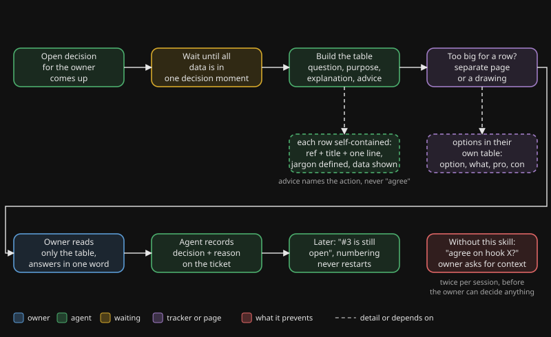

# presenting-decisions

## Waarom

Een agent die voor een drukke eigenaar werkt, eindigt zijn antwoorden met open vragen. Zonder afspraak komen die als kale regels binnen: "akkoord hook X?", "ticket 50 v1-set?". De eigenaar doet meerdere dingen tegelijk, slaat de tekst tussen de tool-calls over en weet niet meer wat ticket 50 is. Om te antwoorden moet hij de context terugzoeken, en dat is precies het werk dat de agent had moeten doen.

Context herhalen kost de agent bijna niets. Context reconstrueren kost de eigenaar veel. De skill maakt van die asymmetrie een vast format.

## Wat het doet

De skill laat de agent elk besluit in een tabel zetten met een vraag, een doel, een begrijpelijke uitleg en een concreet advies. De tabel is zelf-bevattend: wie alleen de tabel ziet kan beslissen, bij voorkeur met één woord. Ook de gewoontes eromheen liggen vast: één rij per besluit, opties in een eigen tabel, data tonen in plaats van beschrijven, stabiele nummering en het antwoord achteraf vastleggen op het ticket.

## Flow

Je ziet dat de agent eerst alle data verzamelt en dan de tabel bouwt met vraag, doel, uitleg en advies. De eigenaar leest alleen de tabel en antwoordt met één woord. Daarna legt de agent het besluit en de reden vast op het ticket.

## Wanneer wel, wanneer niet

| Wel gebruiken | Overslaan |
|---|---|
| Er wachten één of meer besluiten op de eigenaar | Een pure statusmelding zonder iets te beslissen |
| Een samenvatting bevat open punten die de eigenaar moet beoordelen | Een vraag die je zelf kunt beantwoorden door een bestand te lezen |
| De eigenaar vraagt "welke?" of "wat is X?" | Een ja/nee die de eigenaar al in eigen woorden heeft gesteld |
| Een sessie begint met "waar waren we" en open punten | Een chat waarin de eigenaar actief heen en weer typt |
| Een keuze tussen opties met afwegingen | Een triviale default zonder echt alternatief |

## Bewijs

Dit zijn observaties uit het eigen gebruik van de auteur, geen gecontroleerd onderzoek.

- **Medio juni 2026.** De eigenaar moest twee keer per sessie om context vragen, omdat besluiten als kale regels kwamen ("akkoord hook X?"). Daarna werd de tabel verplicht.
- **Eind juni 2026.** Een cel met alle opties van een keuze bleek onleesbaar. Opties krijgen sindsdien een eigen tabel.
- **Begin juli 2026.** Een kale ticket-referentie ("dekt issue 128") was ruis waar de eigenaar niet over kon oordelen. Sindsdien is elke verwijzing een nummer, een titel en één zin.
- **Eind augustus 2026.** Een leek-test faalde: twee van vier rijen waren voor een lezer zonder tools niet te plaatsen. Sindsdien worden termen bij eerste gebruik gedefinieerd en draagt elke rij de keten omhoog.
- **Begin november 2026.** Zonder tekening las de eigenaar de richting van een ontwerp precies verkeerd om. Met twee figuren was het in één blik duidelijk. Sindsdien krijgt een route tussen drie of meer partijen een tekening.

## Installeren

1. Kopieer `skill/` naar `.claude/skills/presenting-decisions/` in je project.
2. Pas twee dingen aan in `SKILL.md`: de naam van je tracker (waar besluit en reden daarna worden vastgelegd) en of je een pagina-kanaal hebt voor grote besluiten. Heb je dat niet, verwijder dan de pagina-regel of verwijs naar elke pagina die je agent kan publiceren.

Zie `examples/how-the-author-uses-it.md` voor één echte opzet.

English version: [README.md](README.md).
